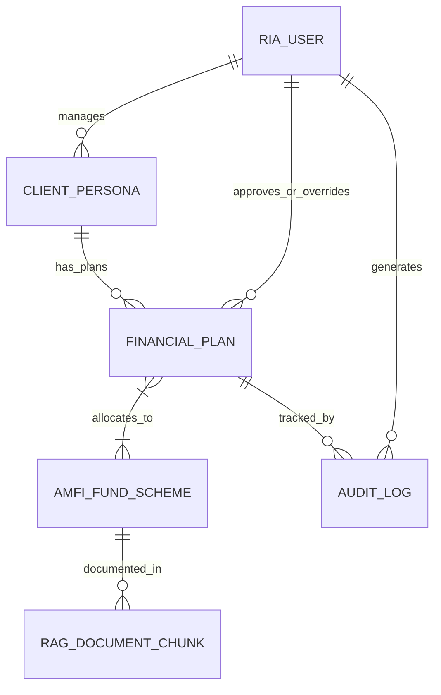

# 02 — Database & Vector Schema Design Document (Locked-In)

**Project:** ArthaGuard AI — SEBI-Registered Investment Adviser (RIA) Co-Pilot (Zeckathon PS 04)  
**Version:** 1.0.0 (Locked)  
**Date:** October 29, 2026  

---

## 1. Storage Architecture Overview

ArthaGuard uses a **Unified MongoDB Atlas Architecture** (Document Store + MongoDB Atlas Vector Search) paired with **Upstash Redis** for low-latency caching and rate-limiting, plus an **Automatic In-Memory / Local JSON Persistence Mirror** so the repository runs with zero external setup during judge evaluation while immediately scaling on MongoDB Atlas when `MONGODB_URI` is provided in `.env`.



---

## 2. Collection Schemas

### 2.1 `users` (SEBI Registered Investment Advisers & Judges)

```typescript
export interface IUser {
  _id: string;
  email: string;                    // Unique index
  passwordHash: string;             // bcrypt (10 rounds)
  fullName: string;                 // e.g., "Achyut Sharma, CFA (SEBI RIA)"
  role: 'RIA_ADVISER' | 'COMPLIANCE_OFFICER' | 'CLIENT_VIEWER' | 'DEMO_JUDGE';
  sebiRegistrationNo: string;       // e.g., "INA000018492"
  firmName: string;                 // e.g., "ArthaGuard Fiduciary Advisory LLP"
  fiduciaryDeclarationAccepted: boolean;
  activeClientsCount: number;       // Target scale: up to 1,000 clients per RIA
  createdAt: Date;
  lastLoginAt: Date;
}
```
**Indexes:** `{ email: 1 } (unique)`, `{ sebiRegistrationNo: 1 }`.

---

### 2.2 `client_personas` (The 6 Zeckathon Personas + Custom Clients)

```typescript
export interface IGoalInput {
  goalId: string;
  name: string;                     // e.g., "Child's Higher Education", "Retirement at 58"
  category: 'EMERGENCY' | 'EDUCATION' | 'RETIREMENT' | 'MEDICAL' | 'WEALTH' | 'SWP_INCOME';
  presentCostInr: number;           // Current cost in INR (or target monthly SWP for retiree)
  horizonYears: number;             // Years to goal
  priority: 'CRITICAL' | 'HIGH' | 'MEDIUM';
  existingEarmarkedCorpusInr: number;
}

export interface IClientPersona {
  _id: string;
  personaCode: string;              // e.g., "PS04-P1" to "PS04-P6" or custom UUID
  name: string;                     // e.g., "Fresh Graduate, Bengaluru"
  age: number;
  city: string;
  occupation: string;
  situationSummary: string;         // Exact prompt description from PS 04
  goalTestSummary: string;          // Exact goal/test from PS 04
  financials: {
    monthlyTakeHomeInr: number;
    monthlyExpensesInr: number;
    monthlyEmiInr: number;
    liquidCashHoldingsInr: number;
    existingEquityInr: number;
    existingDebtPensionInr: number;
    incomeStability: 'SALARIED_STABLE' | 'DUAL_INCOME' | 'IRREGULAR_BUSINESS' | 'PENSION_RETIREE' | 'VOLATILE_TRADER';
    dependantsCount: number;
  };
  behaviouralQuestionnaire: {
    drawdownReaction: 'SELL_ALL' | 'HOLD_NERVOUSLY' | 'HOLD_CALMLY' | 'BUY_MORE';
    returnPreference: 'CAPITAL_SAFETY' | 'BALANCED' | 'HIGH_GROWTH' | 'FAST_HIGH_RETURNS';
    marketExperience: 'NONE_FD_ONLY' | 'MUTUAL_FUNDS' | 'DIRECT_EQUITY' | 'FNO_LOSSES';
    maxAcceptableDrawdownPct: number;
    clientStatedRequest?: string;   // e.g., "I want 100% small-cap exposure" or "High returns fast to recover F&O losses"
  };
  goals: IGoalInput[];
  assignedAdviserId: string;
  isOfficialSample: boolean;
  createdAt: Date;
  updatedAt: Date;
}
```
**Indexes:** `{ personaCode: 1 } (unique)`, `{ assignedAdviserId: 1, isOfficialSample: -1 }`.

---

### 2.3 `financial_plans` (Risk Profile, Goal Plans, Portfolio, Backtest & HITL State)

```typescript
export interface IFinancialPlan {
  _id: string;
  planReferenceCode: string;        // e.g., "AG-PLAN-2026-0001"
  personaId: string;
  personaSnapshot: IClientPersona;
  
  // Deliverable 01: Risk Profiling
  riskProfile: {
    riskCapacityScore: number;      // 0 - 100
    riskCapacityTier: string;
    capacityBreakdown: {
      horizonScore: number;
      liquidityScore: number;
      debtBurdenScore: number;
      incomeStabilityScore: number;
      dependantsScore: number;
    };
    riskToleranceScore: number;     // 0 - 100
    riskToleranceTier: string;
    toleranceBreakdown: {
      drawdownReactionScore: number;
      returnPreferenceScore: number;
      experienceScore: number;
      volatilityComfortScore: number;
    };
    conflictDetected: boolean;
    conflictDelta: number;
    conflictResolutionRuleApplied: string;
    effectiveRiskScore: number;     // Resolved final score
    effectiveRiskTier: 'CONSERVATIVE' | 'MODERATELY_CONSERVATIVE' | 'MODERATE' | 'MODERATELY_AGGRESSIVE' | 'AGGRESSIVE';
    maxAllowedEquityPct: number;
    rationaleNarrative: string;
  };

  // Deliverable 02: Goal-Based Plan & Glide Path
  goalPlans: Array<{
    goalId: string;
    goalName: string;
    category: string;
    horizonYears: number;
    presentCostInr: number;
    assumedInflationPct: number;    // RBI DBIE grounded
    assumedPortfolioReturnPct: number;
    futureCorpusRequiredInr: number;
    existingCorpusFutureValueInr: number;
    netCorpusGapInr: number;
    requiredMonthlySipInr: number;
    stepUpSip10PctInitialInr: number;
    recommendedLumpSumDeploymentInr: number;
    swpMonthlyPayoutInr?: number;   // For Retiree Persona 5
    assetAllocation: {
      equityPct: number;
      debtPct: number;
      hybridGoldPct: number;
      liquidPct: number;
    };
    glidePathSchedule: Array<{
      yearOffset: number;
      calendarYear: number;
      yearsRemaining: number;
      phaseLabel: string;
      equityPct: number;
      debtPct: number;
      hybridGoldPct: number;
      liquidPct: number;
      rebalancingAction: string;
    }>;
  }>;

  // Deliverable 03: AMFI Direct-Plan Shortlist & 10-Year Backtest
  portfolioConstruction: {
    blendedAllocation: {
      equityPct: number;
      debtPct: number;
      hybridGoldPct: number;
      liquidPct: number;
    };
    shortlistedFunds: Array<{
      schemeCode: string;
      schemeName: string;
      amcName: string;
      sebiCategory: string;
      assetClass: 'EQUITY' | 'DEBT' | 'HYBRID' | 'LIQUID';
      weightPct: number;
      monthlySipAllocationInr: number;
      lumpSumAllocationInr: number;
      expenseRatioPct: number;
      aumCr: number;
      managerName: string;
      managerTenureYears: number;
      trackingErrorPct: number | null;
      rollingReturn3YrCagrPct: number;
      rollingReturn5YrCagrPct: number;
      cagr10YrPct: number;
      maxDrawdownPct: number;
      sharpeRatio: number;
      selectionScore: number;
      selectionCriteriaSummary: string;
      citationRef: string;          // e.g., "[PPFAS Flexi Cap Factsheet Oct 2026, p. 1]"
    }>;
    tenYearBacktest: {
      startYear: number;            // 2016
      endYear: number;              // 2026
      initialInvestmentInr: number; // 10,00,000
      portfolioFinalValueInr: number;
      benchmarkFinalValueInr: number;
      portfolioCagr10YrPct: number;
      benchmarkCagr10YrPct: number;
      alphaPct: number;
      maxDrawdownPct: number;
      benchmarkMaxDrawdownPct: number;
      annualizedVolatilityPct: number;
      sharpeRatio: number;
      sortinoRatio: number;
      yearlySeries: Array<{
        year: number;
        portfolioReturnPct: number;
        benchmarkReturnPct: number;
        portfolioValueInr: number;
        benchmarkValueInr: number;
        drawdownPct: number;
      }>;
    };
  };

  // Deliverable 05: Guardrails & HITL Approval Gate
  complianceGuardrails: {
    passedAllHardRules: boolean;
    noReturnGuaranteeVerified: boolean;
    conflictOfInterestDisclosure: string;
    suitabilityAlerts: Array<{
      code: string;
      severity: 'INFO' | 'WARNING' | 'CRITICAL_BLOCK';
      title: string;
      description: string;
      sebiRegulationRef: string;
      remediationApplied: string;
    }>;
  };

  approvalWorkflow: {
    status: 'PENDING_ADVISER_REVIEW' | 'APPROVED_BY_RIA' | 'OVERRIDDEN_AND_APPROVED' | 'REJECTED_BY_RIA';
    clientExportUnlocked: boolean;
    reviewedByAdviserName?: string;
    reviewedBySebiRegNo?: string;
    adviserNotes?: string;
    overrideRationale?: string;
    digitalSignatureHash?: string;
    approvedAt?: Date;
  };

  generationLatencyMs: number;
  createdAt: Date;
}
```

---

### 2.4 `amfi_schemes` (Direct-Plan Mutual Fund Universe)

Stores verified AMFI Direct-Plan Growth schemes across Core Equity (Large Cap Index, Flexi Cap, Mid Cap, Small Cap), Hybrid (Balanced Advantage, Aggressive Hybrid, Multi-Asset), Debt (Short Duration, Corporate Bond, Gilt), and Liquid/Overnight categories, with complete 2016–2026 annual return vectors, TER, AUM, Tracking Error, Max Drawdown, and Manager Tenure.

---

### 2.5 `rag_chunks` (MongoDB Atlas Vector Search + Hybrid Keyword Index)

```typescript
export interface IRagChunk {
  _id: string;
  chunkId: string;                  // e.g., "DOC-PPFAS-SID-P14-C01"
  documentId: string;               // e.g., "DOC-PPFAS-SID-2026"
  documentTitle: string;            // e.g., "Parag Parikh Flexi Cap Fund - SID & Factsheet"
  documentType: 'FACTSHEET' | 'SID' | 'PORTFOLIO_DISCLOSURE' | 'SEBI_REGULATION' | 'RBI_DBIE_MACRO';
  schemeCode?: string;
  amcName?: string;
  pageNumber: number;               // Mandatory exact page number for citation
  sectionHeading: string;
  content: string;                  // Verbatim factual text from SID/Factsheet
  structuredFacts: Record<string, string | number>;
  keywords: string[];
  embedding: number[];              // 768-dim vector (Gemini text-embedding-004 / deterministic TF-IDF cosine vector)
}
```

#### MongoDB Atlas Vector Search Index Definition (`vector_index_rag_chunks`)
```json
{
  "fields": [
    {
      "type": "vector",
      "path": "embedding",
      "numDimensions": 768,
      "similarity": "cosine"
    },
    {
      "type": "filter",
      "path": "documentType"
    },
    {
      "type": "filter",
      "path": "schemeCode"
    }
  ]
}
```

---

### 2.6 `audit_logs` (Immutable Compliance & HITL Ledger)

Tracks every plan generation, suitability flag, adversarial guardrail block, RAG citation lookup, and RIA approval sign-off with SHA-256 integrity hash.
