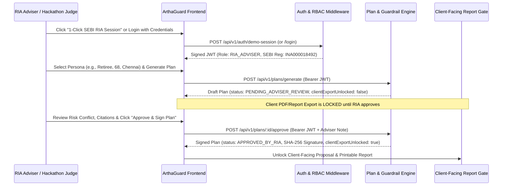

# 03 — Authentication, RBAC & Regulatory Security Specification (Locked-In)

**Project:** ArthaGuard AI — SEBI-Registered Investment Adviser (RIA) Co-Pilot (Zeckathon PS 04)  
**Version:** 1.0.0 (Locked)  
**Date:** October 29, 2026  

---

## 1. Authentication & Fiduciary Access Model

Under **SEBI (Investment Advisers) Regulations, 2013 (Regulation 15 & 17)**, an automated tool or AI co-pilot cannot independently issue investment advice to a retail investor without supervision and sign-off by a registered Investment Adviser (RIA) or Principal Officer.

ArthaGuard enforces this regulatory requirement at the authentication and authorization layer.



---

## 2. Role-Based Access Control (RBAC) Matrix

| Capability / Action | `RIA_ADVISER` | `DEMO_JUDGE` (RIA Mode) | `COMPLIANCE_OFFICER` | `CLIENT_VIEWER` |
| :--- | :---: | :---: | :---: | :---: |
| Create / Edit Client Personas | ✅ | ✅ | ❌ | ❌ |
| Run AI Co-Pilot Plan Generation | ✅ | ✅ | ✅ (Read/Test) | ❌ |
| Query RAG Research Assistant | ✅ | ✅ | ✅ | ❌ |
| Run 25-Question & 10-Adversarial Suites | ✅ | ✅ | ✅ | ❌ |
| **Approve / Override Plan for Client** | ✅ | ✅ | ❌ | ❌ |
| View Unapproved Draft Plans | ✅ | ✅ | ✅ | ❌ (**Blocked**) |
| View / Export Approved Client Plan | ✅ | ✅ | ✅ | ✅ (**Only after RIA Sign-Off**) |
| View Immutable Compliance Audit Logs | ✅ | ✅ | ✅ | ❌ |

---

## 3. JWT Token Specification

- **Algorithm:** `HS256` signed with `JWT_ACCESS_SECRET` (and `JWT_REFRESH_SECRET` for refresh flow).
- **Access Token Payload:**
  ```json
  {
    "sub": "usr_ria_01",
    "email": "adviser@arthaguard.in",
    "fullName": "Vikramaditya Rao, CFA",
    "role": "RIA_ADVISER",
    "sebiRegistrationNo": "INA000018492",
    "firmName": "ArthaGuard Fiduciary Advisory LLP",
    "iat": 1761736800,
    "exp": 1761823200
  }
  ```
- **Frictionless Judge Evaluation Mode:**
  - Because Hackathon Judges evaluate "Adviser time saved (Timed live demo: persona to adviser-approved plan)", the UI boots with an active or 1-click **"SEBI RIA Fiduciary Session (`INA000018492`)"** token pre-negotiated via `/api/v1/auth/demo-session`, while also providing a full Login/Switch Role modal so judges can test both the **Adviser Workbench View** and the **Locked vs. Unlocked Client View**.

---

## 4. Cryptographic Plan Approval Seal

When an RIA approves a plan via `POST /api/v1/plans/:planId/approve`, the backend computes a deterministic SHA-256 approval seal:

$$\text{SealHash} = \text{SHA256}(\text{planId} \parallel \text{personaId} \parallel \text{sebiRegNo} \parallel \text{effectiveRiskScore} \parallel \text{totalMonthlySip} \parallel \text{timestampISO})$$

This seal is persisted in `financial_plans.approvalWorkflow.digitalSignatureHash` and `audit_logs`, proving that the exact numbers shown to the client were reviewed and authorized by the named SEBI RIA.

---

## 5. API Security & Rate Limiting Policies

1. **Helmet & CORS Hardening:** Strict Content-Security-Policy, XSS protection, and configurable `CORS_ORIGINS`.
2. **Tiered Rate Limiting (`express-rate-limit`):**
   - `/api/v1/health/*`: `300 req / min` (unrestricted for Render keep-alive and uptime monitors).
   - `/api/v1/auth/*`: `30 req / min` per IP (brute-force protection).
   - `/api/v1/plans/*`, `/api/v1/rag/*`, `/api/v1/guardrails/*`: `120 req / min` per IP (allows burst testing of the 6 personas, 25 fund questions, and 10 adversarial prompts during judging).
3. **Input Sanitization:** Strict schema validation and prompt-injection stripping before any text reaches the `AIProviderGateway`.
