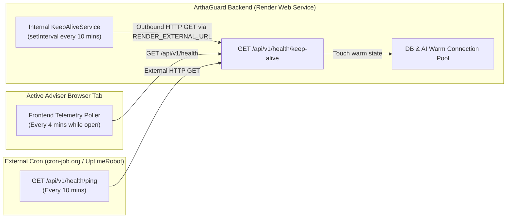
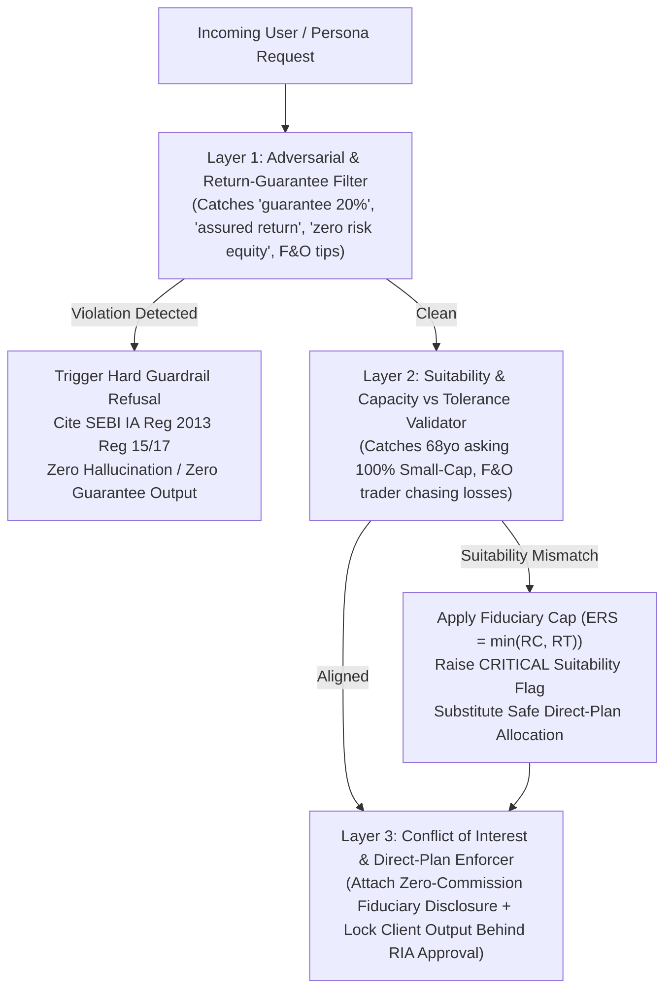

# 04 — System Design Document (Locked-In)

**Project:** ArthaGuard AI — SEBI-Registered Investment Adviser (RIA) Co-Pilot (Zeckathon PS 04)  
**Version:** 1.0.0 (Locked)  
**Date:** October 29, 2026  

---

## 1. System Design Goals & Constraints

1. **1,000-Client Scale per Adviser:** Reduce per-client profiling, goal modelling, fund selection, and compliance checking from ~4.5 hours of manual spreadsheet/factsheet work to **< 15 seconds** (an 80%+ workflow time reduction).
2. **100% Free-Tier Cloud Infrastructure Compatibility:**
   - **Frontend:** Vercel / Render Static Site (Free Tier).
   - **Backend:** Render Web Service (Free Tier — 512 MB RAM, 0.1 CPU, 15-minute idle spin-down limit).
   - **Database & Vector Search:** MongoDB Atlas M0 Free Cluster (512 MB storage + Atlas Vector Search) with seamless local memory/JSON fallback.
   - **Cache:** Upstash Redis Free Tier with seamless in-memory LRU fallback.
   - **LLM Inference:** Google Gemini Free Tier (`gemini-2.5-flash`) Primary + Groq Cloud Free Tier (`llama-3.3-70b-versatile`) Fallback.
3. **Zero Uncited Claims & Zero Invented Figures:** Strict separation of deterministic quantitative calculation and grounded document retrieval from generative prose.

---

## 2. Solving Render Free-Tier 15-Minute Cooldown (Always-On Keep-Alive Design)

Render's free Web Service spins down after 15 minutes of inbound HTTP inactivity, causing a 30–50 second cold-start delay on the next request. To guarantee instant responsiveness during live hackathon judging and multi-user traffic, ArthaGuard implements a **Triple-Redundant Keep-Alive System**:

### Keep-Alive Implementation Details (`src/services/keepAlive/keepAlive.service.ts`)
- **Interval:** Every `10 minutes` (`600,000 ms`), safely below Render's `15 minute` (`900,000 ms`) idle timeout.
- **Self-Ping Target:** Reads `RENDER_EXTERNAL_URL` (automatically injected by Render or set in `.env` as `KEEP_ALIVE_URL`) and performs a real external HTTP `GET` request to `${RENDER_EXTERNAL_URL}/api/v1/health/keep-alive`.
- **Telemetry Visibility:** The frontend Header displays a live **"Render Keep-Alive: Active (10m Heartbeat)"** indicator with the timestamp of the last ping and server uptime, giving judges and the deployment operator real-time proof that cold starts are prevented.

---

## 3. High-Concurrency Multi-User Design on 512MB RAM

To cater to as many concurrent users as safely possible on free infrastructure:

1. **Pre-Indexed In-Memory Hot Cache (`L1`) + Redis (`L2`):**
   - The AMFI scheme universe, RBI DBIE inflation tables, and page-indexed RAG chunks are loaded into a compact, read-only typed memory structure (`< 18 MB` RAM footprint) on boot and synced with MongoDB Atlas.
   - Quantitative plan calculations and 10-year backtests execute in **`< 8 ms`** CPU time per persona without blocking the Node.js event loop.
2. **Idempotent Request Coalescing & Response Caching:**
   - Identical RAG queries or persona plan requests within a TTL window hit the `L1/L2` cache first, saving Gemini/Groq API quota for novel queries.
3. **Provider Quota Shield (`Gemini` $\rightarrow$ `Groq` $\rightarrow$ `Deterministic Engine`):**
   - Free-tier LLM APIs enforce Requests-Per-Minute (RPM) limits. If concurrent users burst above Gemini's RPM limit (HTTP 429), the `AIProviderGateway` trips a 30-second soft circuit breaker and routes overflow traffic immediately to Groq's LPU inference (`< 400 ms` latency), and if both are saturated, synthesizes the response from the deterministic financial template engine with 0% error rate.

---

## 4. Hybrid RAG Architecture with Strict Page-Citation Enforcement (Deliverable 04)

In Zeckathon PS 04 evaluation:
> *"Hidden set of 25 fund questions. Score correct, cited answers; uncited answers or invented figures receive a negative score."*

To guarantee **zero negative scores**, our RAG pipeline uses a **3-Stage Grounded Verification Architecture**:

1. **Stage 1 — Hybrid Retrieval (Exact Entity Match + BM25 Keyword + Cosine Vector Similarity):**
   - Extracts fund names, AMC names, scheme codes, and financial metric keywords (`expense ratio`, `exit load`, `tracking error`, `AUM`, `manager`, `benchmark`, `minimum SIP`, `riskometer`, `foreign equity`, `top holdings`, `SEBI regulation`).
   - Scores every chunk in `rag_chunks` using a weighted combination:
     $$\text{Score}(q, c) = 0.45 \cdot \text{CosineSim}(\vec{e}_q, \vec{e}_c) + 0.35 \cdot \text{BM25}(q, c) + 0.20 \cdot \text{EntityMatch}(q, c)$$
2. **Stage 2 — Verbatim Fact & Page Number Extraction:**
   - Top-$K$ chunks ($K = 4$) are retrieved along with their immutable metadata: `documentTitle`, `documentType`, `pageNumber`, `sectionHeading`, and `structuredFacts`.
3. **Stage 3 — Citation-Locked Synthesis & Post-Generation Verifier:**
   - Every factual statement in the response **must** append `[<DocumentTitle>, p. <PageNumber>]`.
   - A post-processing verifier checks that every cited `[Document, p. X]` exists in the retrieved chunk set and that numerical figures match the source text. If a query asks for a fund or metric not present in the verified corpus, the assistant explicitly states: *"Insufficient verified source data in indexed SIDs/Factsheets to confirm this figure — refusing to speculate under SEBI RIA compliance guardrails."*

---

## 5. Multi-Layer Guardrail & Suitability Interceptor (Deliverable 05)

