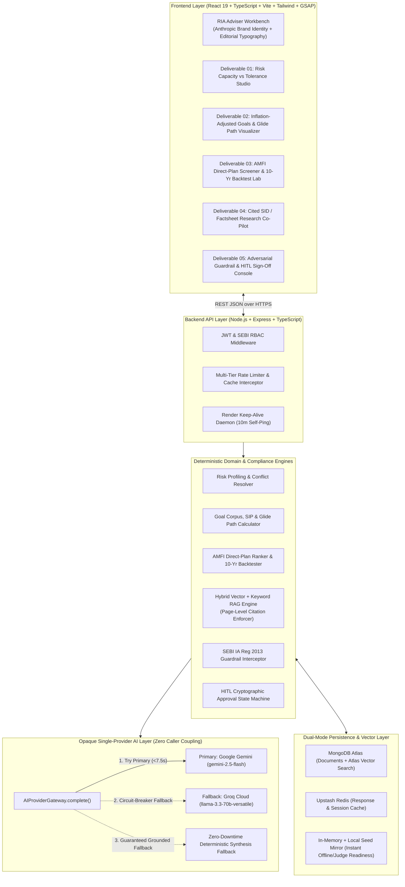
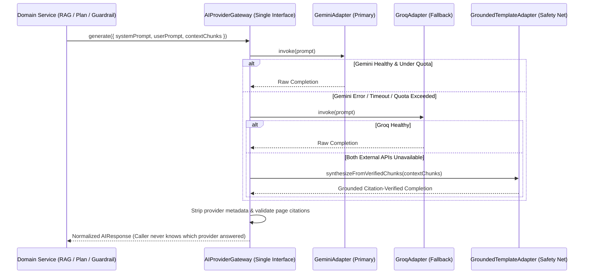

# 05 — System Architecture Document (Locked-In)

**Project:** ArthaGuard AI — SEBI-Registered Investment Adviser (RIA) Co-Pilot (Zeckathon PS 04)  
**Version:** 1.0.0 (Locked)  
**Date:** October 29, 2026  

---

## 1. End-to-End Macro System Architecture

---

## 2. Single-Provider AI Layer Architecture (Requirement #10)

A strict architectural requirement of this project is:
> *"For AI layer, make it with both Gemini and Groq, with Gemini being the primary, Groq being the fallback. There should be a single provider layer, and our system must not know whether they are talking to Gemini or Groq."*

### Architectural Enforcement
1. **Strict Encapsulation:** Neither any route controller (`plans.routes.ts`, `rag.routes.ts`, `guardrails.routes.ts`) nor any domain service (`riskEngine.ts`, `ragEngine.ts`, `guardrailEngine.ts`) imports `@google/genai`, `groq-sdk`, or provider-specific environment variables.
2. **Unified Interface (`src/services/ai/aiGateway.ts`):**
   - Domain modules invoke `await aiGateway.generate(request: AIRequest): Promise<AIResponse>`.
   - Internally, `AIProviderGateway` maintains provider health counters and a circuit-breaker state machine (`CLOSED` $\rightarrow$ `HALF_OPEN` $\rightarrow$ `OPEN`).
   - If `GeminiProvider` succeeds, the response is normalized into standard `{ content, citations, verified }` format.
   - If `GeminiProvider` throws an error, hits rate limit (`429`), or exceeds timeout, `GroqProvider` is transparently invoked within the same call stack without bubbling any provider exception to the caller.

---

## 3. Data Flow: Persona to Adviser-Approved Plan (< 15 Seconds)

1. **Step 1 (0.0s – 0.05s): Persona Ingestion & Risk Separation**
   - `riskEngine.ts` computes `Risk Capacity Score (RC)` from objective balance sheet & cashflow variables and `Risk Tolerance Score (RT)` from behavioural inputs.
   - Applies the Conflict Resolution Rule (`ERS = min(RC, RT)` when tolerance exceeds capacity or age/liquidity constraints trigger) and emits structured conflict flags.
2. **Step 2 (0.05s – 0.10s): Inflation-Adjusted Goal & Glide Path Computation**
   - `goalPlanner.ts` maps each goal to RBI DBIE inflation rates, computes required Future Corpus, deducts existing earmarked assets, solves for exact monthly SIP & 10% step-up SIP, and builds the multi-stage Glide Path table from Year 0 to Goal Maturity.
3. **Step 3 (0.10s – 0.15s): AMFI Direct-Plan Shortlisting & 10-Year Backtest**
   - `portfolioBuilder.ts` filters the AMFI Direct-Plan universe by TER, Tracking Error, 3Y/5Y Rolling Returns, Max Drawdown, AUM, and Manager Tenure.
   - Executes a 10-year historical simulation (2016–2026) comparing the blended portfolio against Nifty 50 TRI and CRISIL Hybrid 35+65 Index.
4. **Step 4 (0.15s – 1.2s): SEBI Guardrail Validation & Cited AI Executive Rationale**
   - `guardrailEngine.ts` audits the plan against SEBI IA Regulations 2013 (checking for unsuitable requests like 68yo asking for 100% small-cap, or F&O loss recovery speculation).
   - `aiGateway.ts` generates the executive advisory memo citing exact SID/Factsheet page numbers.
5. **Step 5 (Human-in-the-Loop Gate): Adviser Review & Cryptographic Sign-Off**
   - The plan lands in `PENDING_ADVISER_REVIEW`. Client export is locked.
   - The RIA inspects the conflict resolution, glide path, 10-year backtest, and citations, then clicks **"Approve & Sign Plan for Client"**, generating an immutable SHA-256 signature and unlocking the Client Report.
