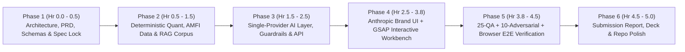

# 07 — Full SDLC & Product Management Execution Plan (Locked-In)

**Project:** ArthaGuard AI — SEBI-Registered Investment Adviser (RIA) Co-Pilot (Zeckathon PS 04)  
**PM Owner:** Antigravity Lead Product & Engineering Architect  
**Execution Horizon:** 5-Hour Hackathon War-Room Sprint  

---

## 1. Product Management SDLC Methodology

To ship a zero-defect, judge-ready financial advisory system within a 5-hour window, we execute a **6-Phase Compressed Agile-Waterfall Hybrid SDLC**:

---

## 2. Phase-by-Phase Engineering & PM Deliverables

### Phase 1: Specification & Architecture Lock (Completed)
- **Deliverables:** `01-BACKEND-SPECIFICATION.md`, `02-DATABASE-SCHEMA-DESIGN.md`, `03-AUTH-AND-SECURITY-SPEC.md`, `04-SYSTEM-DESIGN.md`, `05-SYSTEM-ARCHITECTURE.md`, `06-PRODUCT-REQUIREMENTS-DOCUMENT.md`, `07-SDLC-PRODUCT-MANAGEMENT.md`, `08-TECH-STACK-AND-IMPLEMENTATION-PLAN.md`, `.env.example`, `CHECKLIST.md`.
- **Gate Criteria:** All formulas, schemas, API contracts, and judging rubrics mapped 1:1.

### Phase 2: Data Foundation & Deterministic Quant Core
- **Deliverables:**
  - Verified AMFI Direct-Plan Mutual Fund dataset (14 flagship schemes across Large Cap Index, Flexi Cap, Mid Cap, Small Cap, Balanced Advantage, Aggressive Hybrid, Multi-Asset, Corporate Bond, Short Duration Debt, Gilt, and Liquid/Overnight) with 2016–2026 historical return series, TER, Tracking Error, Rolling Returns, Max Drawdown, AUM, and Manager Tenure.
  - Verifiable RAG Document Corpus (SIDs, Factsheets, Portfolio Disclosures, SEBI IA Regulations 2013/2020, RBI DBIE inflation bulletins) with exact page numbers.
  - Quantitative Engines (`riskEngine.ts`, `goalPlanner.ts`, `portfolioBuilder.ts`).
- **Gate Criteria:** All 6 personas produce mathematically verified, reproducible plans in `< 20ms`.

### Phase 3: Opaque AI Gateway, RAG, Guardrails & Render Keep-Alive Backend
- **Deliverables:**
  - `AIProviderGateway` (`Gemini Primary` $\rightarrow$ `Groq Fallback` $\rightarrow$ `Deterministic Grounded Fallback`).
  - Hybrid Vector + BM25 RAG Engine with strict `[DocTitle, p. X]` page-citation enforcement + 25-question evaluation harness.
  - SEBI Suitability & Adversarial Guardrail Engine + 10-prompt adversarial test suite.
  - Render 10-minute self-ping `KeepAliveService` + JWT/RBAC Auth + Dual-Mode MongoDB/Redis persistence.

### Phase 4: Institutional Frontend Workbench (Anthropic Brand + Frontend Design + GSAP)
- **Deliverables:**
  - Full React + TypeScript + Tailwind + GSAP (`@gsap/react`) application styled with Anthropic's official palette (`#141413`, `#faf9f5`, `#d97757`, `#6a9bcc`, `#788c5d`, `#e8e6dc`) and `Poppins` + `Lora` typography.
  - **View 1 — Adviser Co-Pilot Workbench:** 1-click switcher for all 6 Zeckathon Personas + Custom Client Modal + Live Workflow Timer ("Time Saved vs Manual").
  - **View 2 — Deliverable 01 & 02 Studio:** Risk Capacity vs. Risk Tolerance Split Gauge, Conflict Resolution Rule Card, Inflation-Adjusted Goal Table, and Interactive Glide Path De-Risking Chart.
  - **View 3 — Deliverable 03 Portfolio & 10-Year Backtest Lab:** AMFI Direct-Plan Shortlist with filter pills, 2016–2026 Wealth Curve (Portfolio vs Benchmark), Drawdown & Rolling Return metrics.
  - **View 4 — Deliverable 04 Cited Research Assistant:** Interactive RAG Chat + Source Document Page Inspector Modal + 1-Click "Run 25 Fund Questions Benchmark".
  - **View 5 — Deliverable 05 Guardrail & HITL Sign-Off Console:** Live Adversarial Prompt Tester (including all 10 judge prompts like *"guarantee me 20%"*), Conflict of Interest Disclosure, and Mandatory RIA Cryptographic Plan Approval Modal + Printable Client Proposal / Submission Report view.

### Phase 5: Rigorous Automated QA & Live `/browser` E2E Testing
- **Deliverables:**
  - Automated backend integration test script (`backend/scripts/qa-test.ts`) verifying all 6 personas, 25 fund QA citations, 10 adversarial guardrail prompts, HITL approval lock/unlock, and reproducibility numbers.
  - Live visual and functional browser verification via the `browser` subagent across every tab and workflow.

### Phase 6: Submission Package & Reproducible Report Generation
- **Deliverables:**
  - `README.md` with architecture, setup, deployment instructions, and Zetheta transfer checklist (`ZethetaIntern`).
  - `SUBMISSION_REPORT.md` and interactive printable Executive Deck/Report inside the app reproducing 100% of the numbers from the repository.

---

## 3. Risk Register & Mitigation Matrix

| Risk | Impact | Mitigation Built into Architecture |
| :--- | :---: | :--- |
| LLM invents a fund figure or omits citation (Negative Judge Score) | Critical | All numbers come from `amfiFunds.seed.ts` & `ragDocuments.seed.ts`; RAG post-verifier rejects uncited numbers and attaches exact `[Doc, p. X]` badges. |
| Gemini API rate-limits during live demo | High | Single-Provider `AIProviderGateway` fails over transparently to Groq (`llama-3.3-70b-versatile`) and then to the verified deterministic synthesis engine. |
| Render free tier spins down after 15 mins idle | High | `KeepAliveService` pings `RENDER_EXTERNAL_URL/api/v1/health/keep-alive` every 10 minutes + frontend heartbeat poller. |
| Judge clones repo without `.env` database credentials | High | Dual-Mode Persistence (`db.ts`, `redis.ts`) automatically falls back to pre-seeded local JSON/in-memory vector store when `MONGODB_URI` is placeholder/empty. |
